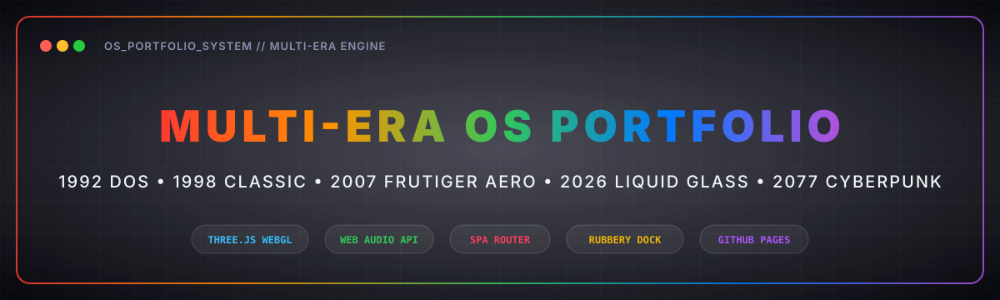

<div align="center">



#  🌈 MULTI-ERA OS PORTFOLIO & DESIGNER TEMPLATE 🌈

<p align="center">
  <strong>An ultra-tactile, interactive desktop operating system portfolio inspired by 35 years of human computing history.</strong><br>
  Featuring 5 eras, 8 draggable windows, interactive 3D cover-stack, WebGL shaders, Web Audio synthesizer, and deep-dive case studies.
</p>

[](https://opensource.org/licenses/MIT)
[](https://threejs.org/)
[](https://www.khronos.org/webgl/)
[](https://pages.github.com/)
[](https://pages.github.com/)

---

</div>

---

## 🌟 Vision & Design Philosophy

This portfolio template isn't just another flat grid of images. It is built as a **tangible computing environment** celebrating the design languages that shaped personal computing:

- **Human-Crafted & Tactile:** Real spring kinematics, sub-16ms responsive feedback, and physical inertia.
- **5 Transformative Eras:** Jump through time from 1992 QBasic DOS to 2077 Cyberpunk with a single scrub.
- **Markdown-Driven Content:** Customize experience, awards, gallery, and brand logos without touching dense JavaScript.
- **Production-Ready & Static:** Runs everywhere without Node build steps—instant deployment on **GitHub Pages**, **Vercel**, **Netlify**, or plain servers.

---

## 👁️ Quick Preview: How to See It Live

### 1. In this Sandbox (Arena Preview)

The development server is already active on port `3000` bound to `0.0.0.0`!  
Simply click the **Preview** or browser icon in your UI, or open:

```text
http://localhost:3000
```

### 2. Locally on Your Machine

Because this project is pure static HTML/ES Modules, you can run it with any static server:

```bash
# Option A: Fast Node.js server (included)
npm start

# Option B: Python 3 one-liner
python3 -m http.server 3000

# Option C: VS Code Live Server
Right-click index.html → "Open with Live Server"
```

---

## ⏳ The 5 Eras

Use the interactive timeline scrubber at the top of the desktop to shift across 35 years of interface craft:

| Era         | Codename        | Visual Identity & Shaders                                                                                                                                             |
| :---------- | :-------------- | :-------------------------------------------------------------------------------------------------------------------------------------------------------------------- |
| **1992**    | _DOS Terminal_  | Amber/Green phosphor CRT monitor, curved glass reflection, scanlines, monospace VT323 font, live QBasic code typewriter, and real-time ASCII art video!               |
| **1998**    | _Classic OS_    | Beveled window borders, Mac OS 8 / Win 98 titlebars, pixel close buttons, 2x retro pixel cursors, and Bayer-dithered **PixelBlast** WebGL canvas.                     |
| **2007**    | _Frutiger Aero_ | Brushed aluminum window chrome, glossy aqua jelly buttons, drop shadows, water reflections, and **ColorBends** gradient shader.                                       |
| **Current** | _Liquid Glass_  | Frosted glass blur (`backdrop-filter`), spring physics, dynamic lighting, and macOS Sequoia inspired rubbery dock with parabolic magnification.                       |
| **2077**    | _Cyberpunk_     | Dark neon HUD reticles (`#hud-tl`, `#hud-tr`), live window coordinates readout, 3D bloom tunnel with Three.js, glitch audio-visuals, and futuristic crosshair cursor! |

---

## 🪟 Core Architecture: 8 Desktop Windows

Every window features draggable titlebars, minimize, maximize, stacking order (z-index focus), and responsive mobile drawer adaptation:

1. **`experience.log` (Experience):**
   - Dual tabs: **Companies** (roles, periods, status tags) & **Brands** (client collaborations).
   - View mode switcher: **Icon Grid (⊞)** and **List View (☰)** with breadcrumb navigation and live preview.
   - Dynamic 3D flyout detail card (`expFlyout`) that slides out next to clicked career milestones.
   - Retro DOS tree directory (`C:\KAI\COLLABORATIONS`) in 1992 mode.

2. **`about_me.txt` (Bio & Skills):**
   - Styled as an interactive text editor with font size toggles, Bold/Italic/Underline formatting, and left/center/right alignment.
   - Live status bar with word count indicator.

3. **`awards.xls` (Accolades Spreadsheet):**
   - Interactive spreadsheet format (`awards.xls` / Lotus 1-2-3 / Excel).
   - Live formula bar with cell reference (`B4`), `fx` indicator, and clickable table cells.
   - Sheet tabs (`Sheet1`, `+`) and item counters.

4. **`gallery.exe` (Creative Vault & Editor):**
   - High-end creative studio layout with interactive image manipulation toolbar: Prev/Next, Fit/Fill, Zoom +/- with label, Rotate CW/CCW, Flip Horizontal/Vertical, Invert Colors, and live image resolution display (`1920 × 1080`).
   - Sidebar thumbnail strip loaded dynamically from `gallery.md`.

5. **`reel.mov` (Motion Showreel):**
   - Video player with VHS overlay, tracking static noise, timecode counter (`0:00 / 1:45`), play/pause, and scrub bar.
   - Converts in real-time into animated ASCII text in 1992 era!

6. **`book.pdf` (Monograph Reader):**
   - Interactive publication reader featuring _"The Architecture of Feedback: Designing Tactile Software in an Ambient World"_.
   - Book introduction, rating (★ 4.9), purchase link, and scrollable page preview stack with page indicator.

7. **`message.bat` (Uplink / Contact):**
   - Interactive terminal/email client with live character counter.
   - Anti-bot human confirmation (`Type send to confirm you're human`).
   - Animated "Message Sent" overlay with timestamp and reset controls.

8. **`Ask Kai` (AI Conversational Assistant):**
   - Floating glass-orb bubble with pulsing aura and radar sweep.
   - Suggestion chips and streaming character-by-character typewriter replies.
   - Answers questions about design process, availability, rates, toolstack, case studies, and easter eggs!

---

## 🚀 Single Page Application Views

In addition to the Desktop environment, the site includes:

- **`#view-portfolio` (`/work`):**
  - Clean fullscreen portfolio gallery with 3D cover stack and fluid light-rays WebGL background.
  - Hovering cover items reveals dynamic metadata (Year, Project, Client, Category).
  - Arrow key navigation and fluid view transitions.
- **`#view-case-study` (`/work/:slug`):**
  - Deep-dive editorial case study reader with feathered edge blur masks (`cs-blur-edge`).
  - Sections for hero visuals, executive overview, team credits, deliverables, image grids, metrics, and callouts.
  - Smooth back button navigation to portfolio and desktop.
- **Custom Cursor System:**
  - Dynamic `#cursor-dot` that morphs into contextual pill badges ("VIEW", "DRAG", "OPEN", "PLAY").
  - Futuristic vector crosshair cursor (`#cursor-2077`) in 2077 mode.
- **Web Audio Synthesizer:**
  - Tactile clicks, window minimizes, dock hovers, 8-bit DOS beeps, and cyberpunk sweeps synthesized live via Web Audio API.

---

## 🎨 Customization Guide

All personal content is separated cleanly into plain text and Markdown files:

### 1. Update Career & Experience (`experience.md`)

Open `experience.md` and add or edit your roles:

```markdown
## [2023-2026] | Linear | Principal Product Designer | Remote | ACTIVE

- Leading core interaction design and spatial workflows.
- Architected command palette and keyboard navigation.
```

### 2. Update Awards & Honors (`awards.md`)

Open `awards.md` and edit your spreadsheet entries:

```markdown
2025 | Apple Design Award: Finalist | Aura Spatial Interface
2024 | D&AD Black Pencil: Digital Craft | Synapse Modular Synthesizer
```

### 3. Update Gallery Images (`gallery.md` + `Sample-work/`)

Drop your image files into `Sample-work/` and list them in `gallery.md`:

```markdown
aura_spatial_workspace.png
kinetic_telemetry_hud.png
chronicle_agent_canvas.png
```

### 4. Update Brand Collaborations (`collaborations.md` + `collaborations/`)

Drop your brand SVGs into `collaborations/` and list them in `collaborations.md`:

```markdown
apple.svg
stripe.svg
linear.svg
```

### 5. Update Detailed Case Studies (`case-studies.json`)

Open `case-studies.json` to customize project names, summaries, teams, deliverables, and image sections.

### 6. Change Your Name & Brand (`index.html`)

Find and replace:

- `Kai Vance` → Your Name
- `k-logo.svg` → Your SVG logo
- Social links (LinkedIn, GitHub, Dribbble, Medium, X) in `top-bar` and `bottom-bar`.

---

## 📁 Repository Structure

```text
├── index.html                 # Main Single Page App (Desktop, Portfolio, Case Studies)
├── 404.html                   # SPA router fallback for GitHub Pages
├── server.js                  # Fast Node.js preview server with SPA fallback
├── package.json               # Package configuration & scripts
├── .gitignore                 # Clean Git ignore file
├── case-studies.json          # 5 deep-dive case study datasets
├── experience.md              # Career experience dataset
├── awards.md                  # Awards & spreadsheet dataset
├── gallery.md                 # Gallery items list
├── collaborations.md          # Brand collaborations list
├── showreel.md                # Video IDs for showreel per theme
├── pixelblast.js              # 1998 Bayer-dithered WebGL shader
├── colorbends.js              # 2007 Frutiger Aero WebGL shader
├── k-logo.svg                 # Vector monogram logo
├── r-logo.svg                 # Fallback vector monogram logo
├── file-image.svg             # File type UI icon
├── linkedin-logo-fill.svg     # Social brand icons
├── dribbble-logo-fill.svg
├── medium-logo-fill.svg
├── github-logo-fill.svg
├── section-icons/             # 8 Tactile 3D dock icons (About, Awards, Book, etc.)
│   └── 1998/cursors/          # 6 Retro 1998 pixel cursors (arrow, hand, crosshair)
├── UI-icons/1998/             # 9 Retro 1998 window chrome icons (close, enlarge, etc.)
├── collaborations/            # 12 Brand vector SVGs (Apple, Stripe, Linear, etc.)
├── Sample-work/               # 16 High-res design artifact images
├── book-pages/                # 20 Monograph book preview pages
├── images/
│   ├── favico.svg             # Browser favicon
│   ├── og-image.png           # Social Open Graph sharing card
│   ├── readme-banner.svg      # Rainbow animated README banner
│   └── work/                  # 17 Case study cover & section visuals
├── src/
│   └── main.js                # Core SPA router, cover stack 3D, chat assistant
└── work/
    └── index.html             # Direct route fallback for /work
```

---

## 📄 License

This template is licensed under the **MIT License**. You are free to customize, modify, and use it for your personal or commercial portfolio.

<div align="center">

Crafted with care, precision, and respect for the pioneers of human-computer interaction.  
_Designed for builders, thinkers, and digital craftsmen._

</div>

<div align="center">

## 🌟 Support the Project

If you find this template useful, please consider giving it a star! It helps others discover the repository and supports future development.

</div>
